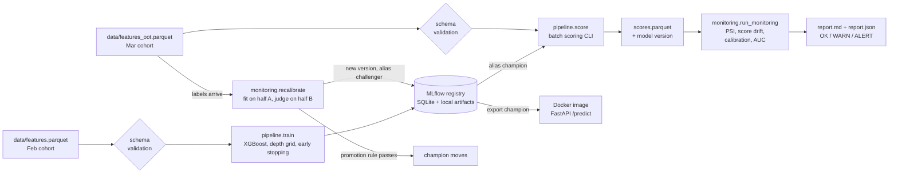

# From notebook to production: drift monitoring and recalibration

The notebook trains a churn model and finds one problem: tested on the next month, the ranking holds (ROC-AUC 0.873) but the probabilities do not (predicted 6.5% churn, actual 9.0%). This part of the repo is what happens after that finding: a reproducible training pipeline, a model registry, batch scoring, a monitoring job that catches the incident, a recalibration that fixes it without leaking labels, and a containerised API.

Nothing here changes the notebook, `src/`, or the existing parquet files. Feature building (raw Kaggle CSVs to `data/*.parquet`) stays upstream in `src/build_features.py`. The raw CSVs are no longer on disk, so this pipeline starts from the feature parquets.

## Architecture



A model version in the registry is one folder (a "bundle"): the XGBoost booster, the pinned feature list and category vocabularies, the calibrator, training metadata, and a frozen reference profile of the training data. Training, batch scoring, monitoring and the API all load that same bundle through one class (`pipeline/scorer.py`), so there is one implementation of "raw rows in, probability out".

| Path | Role |
|---|---|
| `pipeline/schema.py` | Input contract: columns, dtypes, ranges, null limits. Fails loudly, lists every violation |
| `pipeline/features.py` | The single preprocessing path; categories pinned in JSON |
| `pipeline/train.py` | Validate, train, evaluate, log to MLflow, register, set alias |
| `pipeline/score.py` | Batch scoring by alias or version |
| `pipeline/registry.py` | MLflow helpers; `list`, `promote`, `rollback` |
| `pipeline/calibration.py` | Prior-shift, Platt and isotonic calibrators (JSON-serialisable) |
| `monitoring/psi.py`, `drift.py` | PSI with frozen bins; drift, calibration and performance checks |
| `monitoring/run_monitoring.py` | The monitoring job and its report |
| `monitoring/recalibrate.py` | Leak-free recalibration, registration, promotion rule |
| `service/` | FastAPI app and Dockerfile |
| `tests/` | 63 pytest tests, none needing the real data |
| `monitoring/reports/` | The reports from the March run described below |

## Run it

Set up (the existing `.venv` plus the production extras):

```bash
.venv/bin/pip install -r requirements.txt -r requirements-prod.txt
```

Each stage, from the repo root. `make all` runs the first four.

```bash
# 1. Train on the Feb cohort, evaluate, log to MLflow, register v1 as `champion`   (~2-5 min)
.venv/bin/python -m pipeline.train

# 2. Batch-score the March cohort with whatever `champion` points at
.venv/bin/python -m pipeline.score --input data/features_oot.parquet --output outputs/scores/march_v1.parquet

# 3. Monitor that batch against the training reference (exit code 2 = ALERT)
.venv/bin/python -m monitoring.run_monitoring --features data/features_oot.parquet \
    --scores outputs/scores/march_v1.parquet --batch-name "March 2017, champion v1" \
    --out-dir outputs/monitoring/march_v1

# 4. Recalibrate on March labels (fit on half, test on half), register a challenger,
#    promote it only if the rule passes
.venv/bin/python -m monitoring.recalibrate --promote

# Registry operations
.venv/bin/python -m pipeline.registry list
.venv/bin/python -m pipeline.registry rollback          # champion <- previous

# Tests (about 12 s)
.venv/bin/python -m pytest -q

# API: export the champion, build the image, run it
.venv/bin/python -m pipeline.export_champion
docker build -f service/Dockerfile -t kkbox-churn-api .
docker run --rm -p 8000:8000 kkbox-churn-api            # http://localhost:8000/docs
```

To browse runs and the registry: `.venv/bin/mlflow ui --backend-store-uri sqlite:///mlflow.db`. The MLflow store (`mlflow.db`, `mlartifacts/`), `outputs/` and `service/model_bundle/` are gitignored.

## What training reproduces

Same model as the notebook: 23 numeric and 4 categorical features, 80/20 stratified split (seed 42), a further 10% of the training part for early stopping, XGBoost (hist, categorical support, learning rate 0.05), depth chosen from {4, 6, 8}.

| | Notebook | Pipeline |
|---|---|---|
| Validation AUC, depth 4 / 6 / 8 | 0.8977 / 0.8973 / 0.8983 | 0.8977 / 0.8973 / 0.8983 |
| Trees at the early-stopping point | 1025 / 345 / 307 | 1025 / 345 / 307 |
| Feb held-out ROC-AUC, PR-AUC | 0.899, 0.578 | 0.8987, 0.5785 |
| March out-of-time ROC-AUC, PR-AUC | 0.873, 0.601 | 0.8733, 0.6008 |
| March mean predicted vs actual churn | ~6.5% vs 9.0% | 6.51% vs 8.99% |

The notebook prints three decimals, so "matches" means identical at the precision it shows, and the validation AUCs and tree counts are identical. The pipeline uses 4 XGBoost threads (the notebook 8) because the machine is shared; the result was the same on three separate runs.

## Monitoring results on the March cohort

The champion (v1, trained on February) scored the 970,960 March subscribers. Full reports are in `monitoring/reports/`.

**Overall status: ALERT.**

| Component | Status | Evidence |
|---|---|---|
| Feature drift | WARN | 1 feature at PSI ALERT, 2 at WARN, all three on features carrying under 0.5% of model gain |
| Prediction drift | OK | Score PSI 0.007; mean raw score 6.37% (Feb) to 6.51% (Mar) |
| Calibration | ALERT | Mean predicted 6.51% vs actual 8.99% (gap 27.6% of actual); ECE 0.0248 vs 0.0012 at reference |
| Ranking performance | WARN | ROC-AUC 0.8733 vs 0.8987 at reference (-0.025) |

Top drifting features:

| Feature | PSI | Status | Share of model gain |
|---|---|---|---|
| `subscriber_tenure_days` | 0.697 | ALERT | 0.3% |
| `days_to_expiry` | 0.191 | WARN | 0.4% |
| `n_transactions` | 0.159 | WARN | 0.3% |
| `list_price` | 0.013 | OK | 0.6% |

The two features that carry 91% of the model's gain barely moved: `auto_renew` PSI 0.0004, `last_tx_cancel` PSI 0.0001. The three that did move are mechanical effects of moving the cutoff date one month, not changes in subscriber behaviour. `subscriber_tenure_days` counts days from the first transaction to the cutoff, and the data's start is fixed, so the oldest subscribers' tenure shifts by exactly the 28 days the cutoff moved. `n_transactions` most likely accumulates another month of history (it is not the second transactions file: PSI is 0.153 without it). Part of the `days_to_expiry` shift does come from that file (PSI 0.087 without it).

What the report shows is more useful than any single number:

- **Input monitoring alone would have missed the incident.** With labels withheld (`--no-labels`) the status is WARN, from the three mechanical features. Inputs and scores looked stable.
- **Labels exposed it.** Predicted churn is too low in every one of ten equal-count score bins, from 2x too low at the bottom (0.32% vs 0.63%) to 54.3% actual vs 44.6% predicted in the riskiest decile.
- **The cause is not a change in who the subscribers are.** The auto-renew share moved from 88.7% to 88.2%. Churn rose inside each group: auto-renewers 3.0% to 4.5%, manual renewers 32.4% to 41.4%. The conditional churn rate moved, so only label-based checks can see it.

Thresholds were set before looking at March: PSI 0.1 warn and 0.25 alert; calibration gap 10% and 20% of the actual rate; ECE relative to actual rate 10% and 20%; AUC drop 0.01 and 0.03. One rule was added after seeing the data: an ALERT-level PSI on a feature carrying under 1% of model gain is capped at WARN in the component status (the raw PSI status stays in the table). See `DECISIONS_PRODUCTION.md`.

## Recalibration results

Labels for a cohort exist only after its churn window closes, so the calibrator is fitted on one random half of March subscribers (half A, 485,480 users) and every number below is measured on the other half (B, 485,480 users). The booster is untouched; a calibrator is stacked on its raw scores. All three methods are monotone, so they cannot reorder subscribers.

Held-out half B:

| Method | Mean predicted (actual 8.99%) | ECE (equal-count) | ECE (equal-width) | Brier | ROC-AUC | PR-AUC |
|---|---|---|---|---|---|---|
| none (champion v1) | 6.52% | 0.0247 | 0.0247 | 0.05373 | 0.8742 | 0.6028 |
| (a) prior-shift correction | 8.10% | 0.0093 | 0.0105 | 0.05243 | 0.8742 | 0.6028 |
| (b) Platt scaling | 9.01% | 0.0048 | 0.0066 | 0.05240 | 0.8742 | 0.6028 |
| (b) isotonic | 9.01% | 0.0010 | 0.0009 | 0.05215 | 0.8742 | 0.6028 |

Over 10 repeated random splits the ECE is 0.0247, 0.0093, 0.0049 and 0.0010 with standard deviations of 0.0001 to 0.0003, so this is not one lucky split.

- **Prior-shift** adds a constant to the log-odds for the new base rate. It is the cheapest fix and needs only a rate, but it closes only about 60% of the ECE gap: the miscalibration is not a constant shift (the gap is a factor of 2 at the bottom of the ranking and 1.2 at the top).
- **Platt** (slope 0.94, intercept +0.42 in log-odds) fixes the average but not the shape.
- **Isotonic** was chosen by the pre-set rule (lowest held-out ECE among methods that do not hurt AUC or Brier).

Where the new base rate would come from in production: the base rate of the most recent matured cohort, or an early read of renewals inside the churn window. A label-free estimate (the EM algorithm of Saerens et al., which infers the new prior from scores alone) gave 6.71% against a true 8.99%, so it does not work here: it assumes only the base rate moved, and in March the conditional churn rate moved.

**Promotion rule.** The challenger becomes `champion` only if, on held-out data: at least 50,000 users and 1,000 churners; mean predicted within 5% of actual; ECE at most half the champion's; ROC-AUC within 0.001; Brier not worse; and ECE better in every one of the 10 repeated splits. March passed all seven checks, so v2 (isotonic) was registered and promoted; v1 stays reachable as `previous` for rollback (`python -m pipeline.registry rollback`).

The deployed calibrator is refitted on all March labels after the held-out check passed, so v2's own March numbers are in-sample (ECE 0.0002) and are not evidence. The evidence is the table above.

## API

`service/` holds a FastAPI app (`GET /health`, `GET /model`, `POST /predict` for one subscriber or up to 1,000) and a Dockerfile. The request schema is generated from `pipeline/schema.py`, so the API and the pipeline cannot disagree. The image contains no MLflow: `pipeline.export_champion` copies the champion's bundle out of the registry and records which version it came from, and `/model` reports it.

Measured on this machine (Apple Silicon, Docker via Colima, machine under load from other jobs):

| | |
|---|---|
| Image size | 144 MB compressed content, 666 MB unpacked (scipy 118 MB, pandas 84 MB, numpy 40 MB are most of it) |
| Memory at rest | 94 MB |
| Latency, single subscriber | p50 20 ms, p95 24 ms, p99 32 ms (500 requests, includes the HTTP round trip through the VM) |
| Latency, batch of 10 / 100 / 1000 | p50 21 ms / 25 ms / 58 ms |
| Correctness | 200 March subscribers scored through the container matched the batch pipeline exactly (max difference 0.0) |

## Limitations

- **Two cohorts only.** One real drift incident, one recalibration. Nothing here shows how the monitor behaves over a year, or how often to refit.
- **The recalibration protocol cannot prove transfer to April.** Halves A and B are the same month. A calibrator encodes the base rate of the cohort it was fitted on: applied back to February, the March-fitted calibrator predicts 8.84% against a true 6.39%. It must be refitted as each cohort matures, and the champion should be re-monitored on the next cohort before trusting it.
- **Labels arrive late.** The calibration check needs the churn window to close (about 30 days after expiry). Until then only the input and score monitors run, and in the March case they say WARN, not ALERT.
- **PSI has arbitrary thresholds and depends on binning.** The 0.1 and 0.25 rules of thumb come from credit scoring. Features defined relative to a moving cutoff (tenure, transaction counts) drift mechanically every month.
- **The monitor is a batch job, not a scheduler.** Nothing runs it automatically, and there is no paging or dashboard.
- **MLflow uses SQLite and local files.** Fine for one person; a team would need a shared tracking server and object storage.
- **The API has no authentication, rate limiting or request logging,** and latency was measured on a loaded laptop, not a production host.
- **Feature building is not part of this pipeline.** The raw CSVs are gone, so the features cannot be rebuilt here, and `src/build_features.py` is not tested.
- **Environment:** installing MLflow downgraded `pyarrow` from 26.0.0 to 25.0.1 (see `requirements-prod.txt`).
