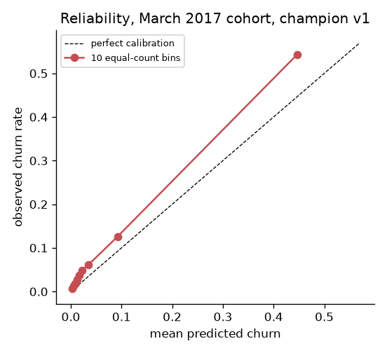
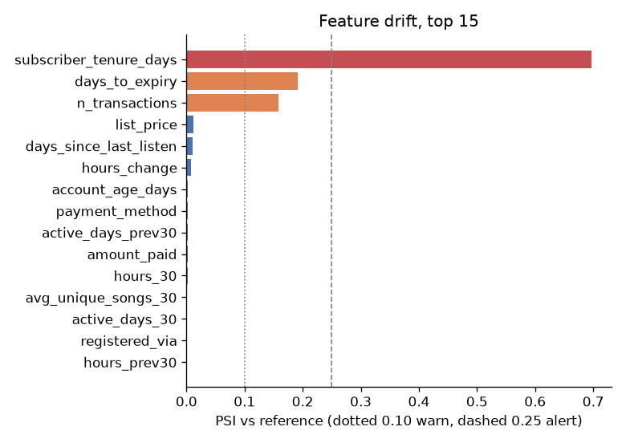

# Monitoring report: March 2017 cohort, champion v1

**Overall status: ALERT**

- Model: `kkbox-churn` v1 (alias `champion`, calibration `identity`)
- Batch: `features_oot.parquet`, 970,960 subscribers
- Reference: training cohort `features.parquet` (frozen profile stored with the model)

| Component | Status |
|---|---|
| feature drift | WARN |
| prediction drift | OK |
| calibration | ALERT |
| ranking performance | WARN |

Thresholds: PSI warn 0.1 / alert 0.25; calibration gap warn 10% / alert 20% of the actual rate; ECE/actual warn 10% / alert 20%; AUC drop warn 0.01 / alert 0.03.

## Prediction drift

- Score PSI vs reference: **0.007** (OK)
- Mean raw score: reference 6.37% -> batch 6.51% (+2.2%)

## Calibration and performance (labels available)

| | Reference (Feb held-out) | This batch |
|---|---|---|
| actual churn rate | 6.39% | 8.99% |
| mean predicted churn | 6.37% | 6.51% |
| predicted / actual | 0.997 | 0.724 |
| ROC-AUC | 0.8987 | 0.8733 |
| PR-AUC | 0.5785 | 0.6008 |
| Brier | 0.03881 | 0.05387 |
| ECE (10 equal-count bins) | 0.0012 | 0.0248 |
| ECE (10 equal-width bins) | 0.0011 | 0.0248 |

- Calibration in the large: gap 27.6% of actual -> **ALERT**
- ECE relative to actual rate: 27.6% -> **ALERT**
- AUC change vs reference: -0.0254 -> **WARN**

Reliability table (equal-count bins, lowest to highest score):

| bin | n | mean predicted | actual | gap |
|---|---|---|---|---|
| 1 | 97,096 | 0.32% | 0.63% | -0.31% |
| 2 | 97,096 | 0.60% | 1.25% | -0.64% |
| 3 | 97,096 | 0.81% | 1.77% | -0.96% |
| 4 | 97,096 | 0.98% | 1.91% | -0.93% |
| 5 | 97,096 | 1.23% | 2.78% | -1.55% |
| 6 | 97,096 | 1.62% | 3.75% | -2.13% |
| 7 | 97,095 | 2.25% | 4.83% | -2.58% |
| 8 | 97,097 | 3.43% | 6.08% | -2.64% |
| 9 | 97,096 | 9.25% | 12.63% | -3.37% |
| 10 | 97,096 | 44.64% | 54.31% | -9.67% |

## Feature drift (ranked by PSI)

1 feature(s) at ALERT, 2 at WARN, of 27 (raw worst-PSI status ALERT; the component status caps ALERTs on features with under 1% of model gain at WARN, because drift in an input the model barely uses cannot move its predictions much).

| # | feature | PSI | status | model importance | null rate ref -> batch | mean ref -> batch |
|---|---|---|---|---|---|---|
| 1 | subscriber_tenure_days | 0.697 | ALERT | 0.3% | 0.2% -> 0.3% | 485 -> 501 |
| 2 | days_to_expiry | 0.191 | WARN | 0.4% | 0.2% -> 0.3% | 16.9 -> 19.1 |
| 3 | n_transactions | 0.159 | WARN | 0.3% | 0.2% -> 0.3% | 15.2 -> 15.8 |
| 4 | list_price | 0.013 | OK | 0.6% | 0.2% -> 0.3% | 150 -> 152 |
| 5 | days_since_last_listen | 0.011 | OK | 0.3% | 12.8% -> 12.4% | 23.5 -> 24.1 |
| 6 | hours_change | 0.008 | OK | 0.1% | 0.0% -> 0.0% | 0.588 -> -0.447 |
| 7 | account_age_days | 0.003 | OK | 0.1% | 11.7% -> 11.3% | 1.25e+03 -> 1.26e+03 |
| 8 | payment_method | 0.003 | OK | 0.4% | 0.2% -> 0.3% |  |
| 9 | active_days_prev30 | 0.002 | OK | 0.3% | 0.0% -> 0.0% | 13 -> 13 |
| 10 | amount_paid | 0.002 | OK | 0.7% | 0.2% -> 0.3% | 149 -> 152 |

Categorical codes unseen in training: payment_method 0.000%
