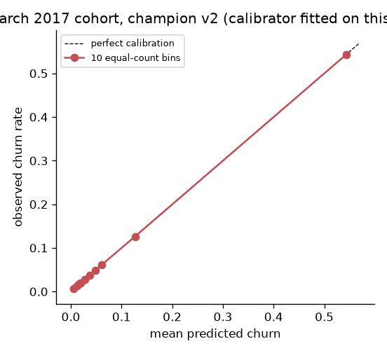

# Monitoring report: March 2017 cohort, champion v2 (calibrator fitted on this cohort: in-sample)

**Overall status: WARN**

- Model: `kkbox-churn` v2 (alias `champion`, calibration `isotonic`)
- Batch: `features_oot.parquet`, 970,960 subscribers
- Reference: training cohort `features.parquet` (frozen profile stored with the model)

| Component | Status |
|---|---|
| feature drift | WARN |
| prediction drift | OK |
| calibration | OK |
| ranking performance | WARN |

Thresholds: PSI warn 0.1 / alert 0.25; calibration gap warn 10% / alert 20% of the actual rate; ECE/actual warn 10% / alert 20%; AUC drop warn 0.01 / alert 0.03.

## Prediction drift

- Score PSI vs reference: **0.007** (OK)
- Mean raw score: reference 6.37% -> batch 6.51% (+2.2%)

## Calibration and performance (labels available)

| | Reference (Feb held-out) | This batch |
|---|---|---|
| actual churn rate | 6.39% | 8.99% |
| mean predicted churn | 6.37% | 8.99% |
| predicted / actual | 0.997 | 1.000 |
| ROC-AUC | 0.8987 | 0.8733 |
| PR-AUC | 0.5785 | 0.6008 |
| Brier | 0.03881 | 0.05224 |
| ECE (10 equal-count bins) | 0.0012 | 0.0002 |
| ECE (10 equal-width bins) | 0.0011 | 0.0000 |

- Calibration in the large: gap 0.0% of actual -> **OK**
- ECE relative to actual rate: 0.2% -> **OK**
- AUC change vs reference: -0.0254 -> **WARN**

Reliability table (equal-count bins, lowest to highest score):

| bin | n | mean predicted | actual | gap |
|---|---|---|---|---|
| 1 | 97,096 | 0.63% | 0.63% | -0.01% |
| 2 | 97,096 | 1.24% | 1.25% | -0.01% |
| 3 | 97,096 | 1.73% | 1.77% | -0.05% |
| 4 | 97,096 | 1.96% | 1.91% | +0.05% |
| 5 | 97,096 | 2.77% | 2.78% | -0.01% |
| 6 | 97,096 | 3.75% | 3.75% | -0.00% |
| 7 | 97,095 | 4.82% | 4.83% | -0.00% |
| 8 | 97,097 | 6.06% | 6.08% | -0.02% |
| 9 | 97,096 | 12.68% | 12.63% | +0.05% |
| 10 | 97,096 | 54.32% | 54.31% | +0.00% |

## Feature drift (ranked by PSI)

1 feature(s) at ALERT, 2 at WARN, of 27. Raw worst-PSI status: **ALERT**. Component status: **WARN**, because an ALERT on a cutoff-relative feature (list below) is capped at WARN. These features drift mechanically as the cutoff date moves. The exemption list was written after seeing the March run and is not validated out of sample.

- exempt `subscriber_tenure_days`: days from first transaction (fixed data start) to the cutoff; upper tail moves by the cutoff shift
- exempt `account_age_days`: days from registration to the cutoff; grows by the cutoff shift
- exempt `days_to_expiry`: expiry date minus the cutoff; depends on which transactions files exist at the cutoff
- exempt `days_since_last_listen`: days from last listening to the cutoff; depends on the log window end
- exempt `n_transactions`: cumulative count of transactions up to the cutoff; grows with each month of history
- exempt `n_cancels`: cumulative count of cancellations up to the cutoff; grows with each month of history

| # | feature | PSI | status | model importance | null rate ref -> batch | mean ref -> batch |
|---|---|---|---|---|---|---|
| 1 | subscriber_tenure_days | 0.697 | ALERT | 0.3% | 0.2% -> 0.3% | 485 -> 501 |
| 2 | days_to_expiry | 0.191 | WARN | 0.4% | 0.2% -> 0.3% | 16.9 -> 19.1 |
| 3 | n_transactions | 0.159 | WARN | 0.3% | 0.2% -> 0.3% | 15.2 -> 15.8 |
| 4 | list_price | 0.013 | OK | 0.6% | 0.2% -> 0.3% | 150 -> 152 |
| 5 | days_since_last_listen | 0.011 | OK | 0.3% | 12.8% -> 12.4% | 23.5 -> 24.1 |
| 6 | hours_change | 0.008 | OK | 0.1% | 0.0% -> 0.0% | 0.588 -> -0.447 |
| 7 | account_age_days | 0.003 | OK | 0.1% | 11.7% -> 11.3% | 1.25e+03 -> 1.26e+03 |
| 8 | payment_method | 0.003 | OK | 0.4% | 0.2% -> 0.3% |  |
| 9 | active_days_prev30 | 0.002 | OK | 0.3% | 0.0% -> 0.0% | 13 -> 13 |
| 10 | amount_paid | 0.002 | OK | 0.7% | 0.2% -> 0.3% | 149 -> 152 |

Categorical codes unseen in training: payment_method 0.000%
