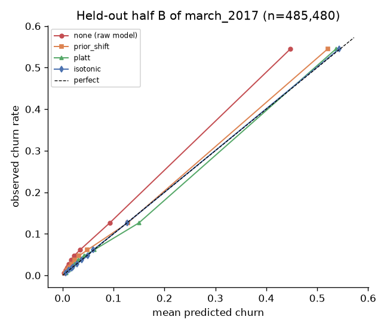

# Recalibration of v1 on march_2017

Fit on random half A (485,480 users), evaluated on half B (485,480 users). Training base rate 6.39%; cohort base rate 8.99%; estimate from A 8.99%; label-free EM estimate 6.71%.

## Held-out half B (seed 42 split)

| method | mean predicted | actual | ECE (equal-count) | ECE (equal-width) | Brier | log loss | ROC-AUC | PR-AUC |
|---|---|---|---|---|---|---|---|---|
| none (raw model) | 6.52% | 8.99% | 0.0247 | 0.0247 | 0.05373 | 0.20091 | 0.8742 | 0.6028 |
| prior_shift | 8.10% | 8.99% | 0.0093 | 0.0105 | 0.05243 | 0.19460 | 0.8742 | 0.6028 |
| platt | 9.01% | 8.99% | 0.0048 | 0.0066 | 0.05240 | 0.19355 | 0.8742 | 0.6028 |
| isotonic | 9.01% | 8.99% | 0.0010 | 0.0009 | 0.05215 | 0.19281 | 0.8742 | 0.6028 |

Chosen by admission rule + lowest held-out ECE: **isotonic**. Registered as v2.

## Repeated splits (mean +/- sd over 10 random 50/50 splits, equal-count ECE)

| method | ECE | mean predicted (actual 8.99%) | Brier | ROC-AUC |
|---|---|---|---|---|
| none (raw model) | 0.0247 +/- 0.0001 | 6.52% | 0.05389 | 0.8733 |
| prior_shift | 0.0093 +/- 0.0002 | 8.10% | 0.05260 | 0.8733 |
| platt | 0.0049 +/- 0.0002 | 9.01% | 0.05257 | 0.8733 |
| isotonic | 0.0010 +/- 0.0003 | 9.01% | 0.05231 | 0.8733 |

## Promotion rule

- PASS: enough_holdout_users
- PASS: enough_holdout_positives
- PASS: calibration_gap_within_5pct
- PASS: ece_at_most_half_of_old
- PASS: auc_unchanged_within_0.001
- PASS: pr_auc_not_degraded
- PASS: brier_not_worse
- PASS: ece_improves_in_every_repeat

Decision: **promote** (champion moved to v2).

## Transfer check (limitation)

Applying the March-fitted calibrator to the Feb cohort: actual 6.39%, raw model 6.38%, recalibrated 8.84%. A calibrator encodes the base rate of the cohort it was fitted on.

